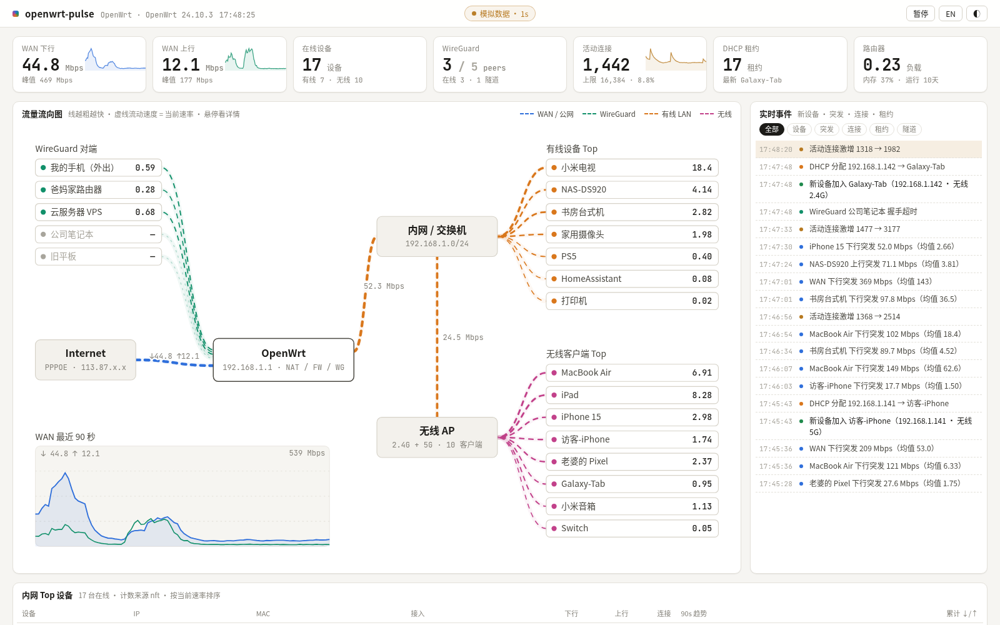
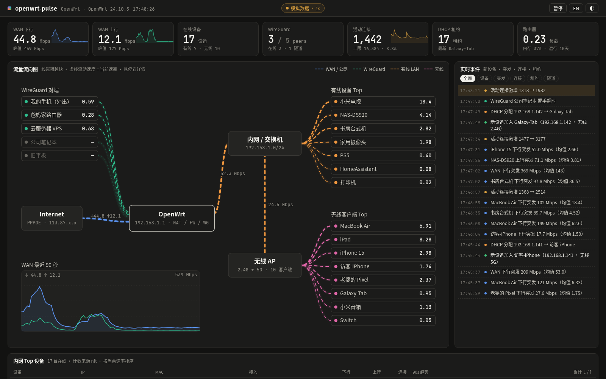
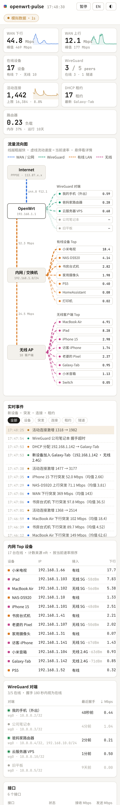
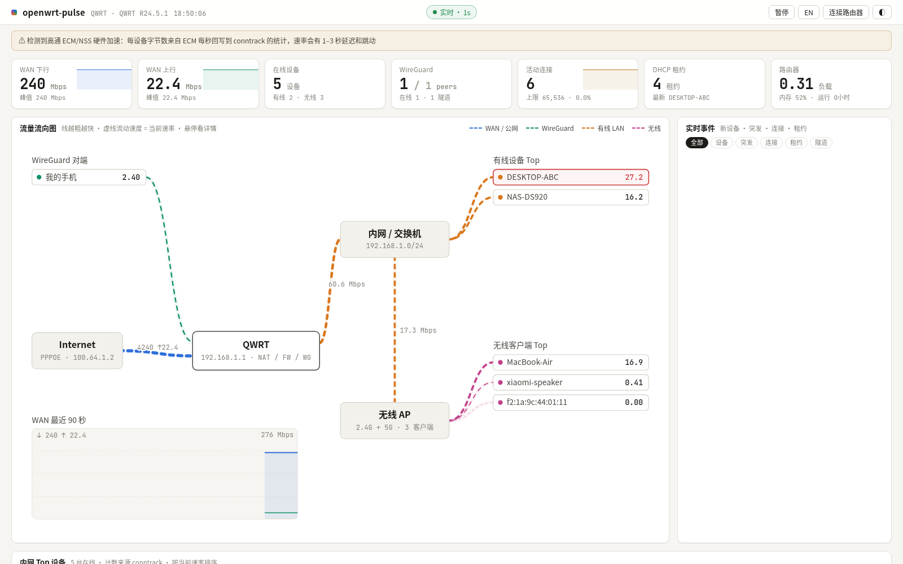

# openwrt-pulse

**Live traffic dashboard for OpenWrt** — topology flow map, per-device rates, WireGuard peers, and a live event stream. Chinese UI by default, English toggle, light/dark theme. Frontend is static (no build step); the router only runs a small CGI collector.

OpenWrt 实时流量面板：一页看清谁在用带宽、流量从哪来到哪去、WireGuard 通不通、连接数有没有暴涨。



<p align="center">
  
  
  
</p>

> 布局思路来自 [routeros-lanpulse](https://github.com/mrtian2016/routeros-lanpulse)（MIT，仅作信息架构参考）。本仓库代码均为独立编写，详见 [NOTICE.md](NOTICE.md)。**不包含、也不展示任何代理 / 科学上网节点。**

---

## 功能

- **顶部指标卡**：WAN 下行 / 上行（峰值 + 90 秒曲线）、在线设备、WireGuard 对端、活动连接、DHCP 租约、路由器负载与内存
- **中间流向图**：Internet → 路由器 → 内网交换机 → 无线 AP → 各设备；虚线按速率流动，颜色区分 WAN / WireGuard / 有线 / 无线
- **右侧事件流**：新设备、DHCP、突发、连接激增、WireGuard 握手超时 / 重连
- **底部表格**：内网 Top 设备（含 90 秒趋势）、WireGuard 对端、接口
- **1 秒刷新**；中文 / English；亮色 / 暗色；窄屏自动竖排流向图
- **前端零构建**（原生 JS + SVG，约 60–90 KB）；采集器是按需启动的 CGI，不常驻内存

---

## 架构

```
浏览器 (web/)  --HTTP-->  路由器 CGI 采集器  --读-->  /proc、ubus、iwinfo、wg、conntrack/nft…
                              │
                    返回累计字节数 JSON
                              │
                    前端求差 → Mbps、峰值、事件、流向图
```

| 目录 | 适用固件 | 采集器 |
|---|---|---|
| [`router/`](router/) | OpenWrt **23.05 / 24.10**（有 ucode、fw4/nftables） | ucode CGI + 可选 nft 每 IP 计数表 |
| [`router19/`](router19/) | OpenWrt **19.07**、QSDK、**QWRT**（京东云 AX1800 Pro 等，无 ucode） | Lua 5.1 CGI；NSS/ECM 下用 conntrack 回写计数 |
| [`web/`](web/) | 两边共用 | 静态页面；可装在路由器 `/www/pulse/`，也可在电脑上打开 |

两边采集器输出**同一套 JSON**，前端完全复用。

---

## 先看效果（不用路由器）

```bash
git clone https://github.com/liujiand-bt/openwrt-pulse.git
cd openwrt-pulse
python3 -m http.server 8765 --directory web
# 打开 http://127.0.0.1:8765/?mock=1
```

双击 `web/index.html` 也会进入模拟模式，并弹出「连接路由器」对话框。

常用 URL 参数：`?mock=1` · `?endpoint=http://192.168.1.1/cgi-bin/pulse` · `?token=…` · `?lang=en` · `?theme=dark`

---

## 安装 · 现代 OpenWrt（23.05 / 24.10）

一般已自带 `ucode`、`nftables-json`、`uhttpd`（装了 LuCI 即可）。

```bash
# 电脑上
scp -O -r openwrt-pulse root@192.168.1.1:/tmp/

# 路由器上
sh /tmp/openwrt-pulse/router/install.sh
# 浏览器打开 http://192.168.1.1/pulse/
```

脚本会安装采集器 `/www/cgi-bin/pulse`、前端 `/www/pulse/`、配置 `/etc/config/pulse`，并创建只计数、不拦截的 nft 表。卸载：`sh /tmp/openwrt-pulse/router/uninstall.sh`。

**每设备计数来源（自动选择）**：nft 每 IP 计数表 → Bandix → conntrack → nlbwmon。详见 `/etc/config/pulse` 的 `counters` 选项。

也可以只装采集器，前端放在电脑上打开（需设置 `cors_origin` 与 `token`）。

---

## 安装 · QWRT / OpenWrt 19.07（无 ucode，如京东云 AX1800 Pro）

路由器 overlay 往往只剩几百 KB：建议**只装采集器（约 32 KB）**，前端在电脑上打开。

完整步骤、scp `-O`、诊断命令、NSS/ECM 说明见 **[router19/INSTALL-QWRT.md](router19/INSTALL-QWRT.md)**。摘要：

```bash
# 打包（在开发机）
tools/build-qwrt.sh          # → dist/pulse-qwrt.tar.gz

# 上传并安装
scp -O dist/pulse-qwrt.tar.gz root@192.168.1.1:/tmp/
ssh root@192.168.1.1
cd /tmp && tar xzf pulse-qwrt.tar.gz
sh /tmp/pulse-qwrt/diag.sh           # 先诊断，不安装
sh /tmp/pulse-qwrt/install.sh tmp    # 临时：全在 /tmp，:8088 小网站
sh /tmp/pulse-qwrt/install.sh        # 常驻：约 32 KB 写入闪存；装完建议重启一次
```

电脑上双击包内 `web/index.html` →「连接路由器」→ `http://192.168.1.1/cgi-bin/pulse` + 口令。

热更新采集器（例如 WiFi 分类修复）：`dist/pulse-qwrt-update.tar.gz`，见包内 `UPDATE.txt`。

---

## 重要限制与准确性

| 场景 | 影响 |
|---|---|
| **firewall flow offloading**（软/硬） | 现代 OpenWrt：每设备 nft/conntrack 计数会严重偏低。要准就关掉 flow offload。WAN 总速率来自网卡计数器，一般仍准。 |
| **高通 NSS + ECM**（QWRT / QSDK） | 加速流量不经 netfilter；iptables/nft 不可靠。Lua 采集器默认读 **conntrack**（ECM 约每秒把字节数回写进去，需 `nf_conntrack_acct=1`）。速率可能有 **1–3 秒延迟和跳动**；面板会自动按约 3 秒窗口平滑。 |
| **独立瘦 AP / 二级路由下的无线客户端** | 主路由看不到对方的 assoclist，这些设备会显示成 **有线**（挂在交换机下）。只有本机 iwinfo / wlanconfig 能枚举的客户端才标无线。 |
| **qcawifi 的 iwinfo** | 旧版 iwinfo 可能把站 MAC 读成 `00:00:00:xx:xx:xx`；`router19` 采集器会优先用 `wlanconfig athX list sta` 的真 MAC。 |
| **内网互拷**（PC ↔ NAS） | 走交换芯片 / 网桥，不经 conntrack，**不会**算进每设备流量。 |
| **IPv6** | 现代版目前每设备主要计 IPv4；QWRT 版在 `ip -6 neigh` 可用时会把 IPv6 连接归到设备。 |

「当前测试状态」：前端与两种采集器均有离线 fixture / 模拟数据测试；**现代 OpenWrt 真机尚未大规模验证**；QWRT（京东云 AX1800 Pro）已在真机跑过采集器与面板。

---

## 安全

- **不要暴露到公网。** 面板含设备名、IP、MAC、WireGuard 端点。不要给 80/443/8088 做端口转发；外出请先连回家的 WireGuard。
- **设置口令**（`/etc/config/pulse` 的 `token`）。安装脚本可自动生成。前端用 `?token=` 或连接对话框保存到本机浏览器。这是共享口令 + 明文 HTTP，只防家里随手打开。
- 采集器**只读**（除非手动把 `counters` 设成 iptables，才会建一条只计数的链）。WireGuard **私钥不会输出**。

---

## 开发

```bash
# 模拟截图
python3 -m http.server 8765 --directory web &
tools/shot.sh

# 现代采集器离线测试（需本机编译 ucode，见脚本注释）
router/test/run-test.sh

# QWRT / Lua 采集器离线测试（需 lua5.1）
router19/test/run-test.sh

# 浏览器 ↔ 采集器 ↔ 假根目录
python3 tools/devserver.py 8780
PULSE_COLLECTOR=lua19 python3 tools/devserver.py 8781
```

---

## 目录

```
web/                 共用前端
router/              OpenWrt 23.05+（ucode + nft）
router19/            OpenWrt 19.07 / QWRT（Lua）；INSTALL-QWRT.md
tools/               截图、联调服务器、QWRT 打包
screenshots/         截图
LICENSE              MIT, Copyright (c) 2026 Liu Jian
NOTICE.md            致谢 routeros-lanpulse 等
```

MIT License
